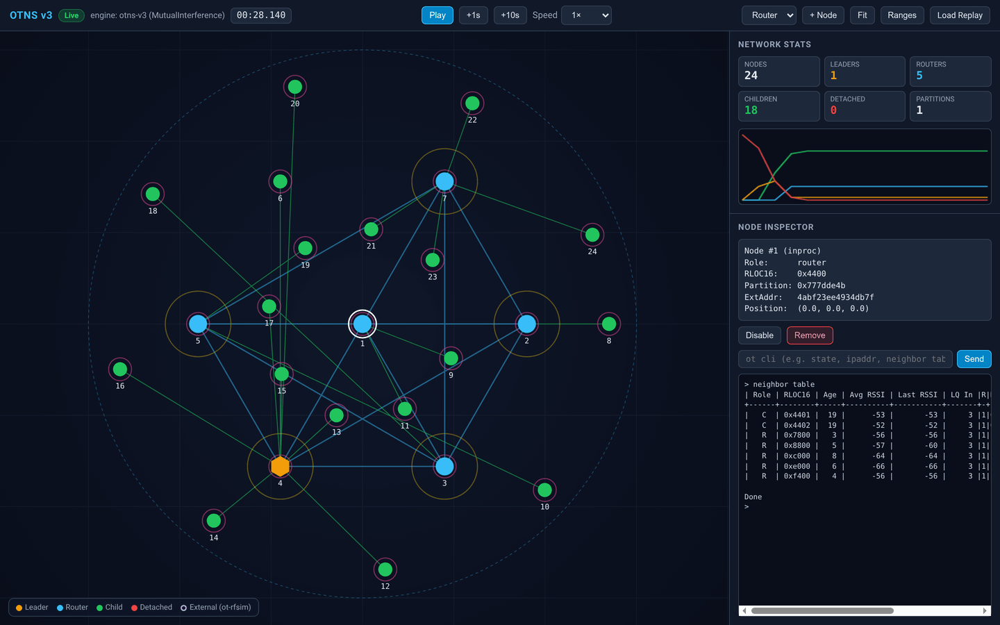

# OpenThread Network Simulator (OTNS v3)

> **Status**: Ground-up C++17 OTNS v3 implementation on the `v3` branch. For legacy Go-based OTNS v2, see the `main` branch.

OTNS v3 is a deterministic C++17 discrete-event Thread 1.4 network simulator and visualizer designed for:

- **High scale**: Supports 200 to 1,000+ in-process multi-instance OpenThread nodes with zero IPC overhead (~85× real time for 200 nodes on a laptop CPU).
- **Heterogeneous and external nodes**: Connects Matter Linux apps, real OTBR/RCPs, and standalone Thread binaries over a versioned binary/TLV `ot-rfsim` v3 Unix or TCP socket bridge sharing the same RF medium and virtual clock.
- **High-fidelity RF physics**: Uses a standalone, zero-OS-dependency C++17 library (`otns_rf`) supporting `Ideal`, `IdealRssi`, `MutualInterference`, `Midisc`, and `Outdoor`. Models include 3GPP/ITU path loss, shadow and time-variant fading, IEEE 802.15.4 SINR/BER, CCA/energy scan, 3D spatial indexing, and deterministic PRNG.
- **Low-maintenance visualization**: Ships an embedded localhost HTTP/1.1 and RFC 6455 WebSocket JSON server with a Vite, TypeScript, and batched HTML5 Canvas 2D UI designed to be shared with `openthread/tests/nexus`. It eliminates Go, Webpack 4, gRPC/Protobuf/proxy chains, and committed generated bundles.



## Platform Support and v2 Differences

- **Core simulator, Web UI, and Python SDK**: Verified on Linux (`x86_64` and `arm64`) and macOS (`macos-15`).
- **OTBR and Matter-over-Thread integration**: Linux only (`otbr-agent` requires `/dev/net/tun` and Linux network namespaces; upstream `connectedhomeip` `chip_enable_otns` is Linux-only).
- **Breaking v2 changes**: The Python SDK (`python/otns`) is redesigned around typed JSON-RPC over WebSocket or Unix domain sockets rather than OTNS v2's Go CLI piping.
- **Deferred post-MVP**: YAML topology import, energy profiling charts, multi-version OpenThread build matrices, and wiring `openthread/tests/nexus` into the shared WebSocket observer remain follow-up work.

## Quick Start

Clone the `v3` branch with the required `openthread` submodule initialized:

```bash
git clone --branch v3 --recurse-submodules https://github.com/openthread/ot-ns.git
cd ot-ns
```

If you already cloned without `--recurse-submodules`, run `git submodule update --init --recursive` first.

### 1. Headless C++17 Build and Tests (Zero Node.js)

Prerequisites: CMake ≥ 3.24, Ninja, a C++17 compiler (GCC or Clang), and Python 3.

```bash
cmake -S . -B build -G Ninja -DOTNS_ENABLE_SANITIZERS=ON
cmake --build build
ctest --test-dir build --output-on-failure
```

### 2. Full Release Build with Embedded Web Visualizer

Requires Node.js ≥ 20. The Vite and TypeScript bundle has zero runtime npm dependencies, is compiled and embedded at CMake build time, and is never committed to Git.

```bash
npm --prefix web ci
cmake -S . -B build-release -G Ninja -DCMAKE_BUILD_TYPE=Release -DOTNS_BUILD_WEB=ON
cmake --build build-release
./build-release/otns --port 8999
```

Open `http://127.0.0.1:8999/` in your browser. Control the simulation from the browser toolbar and Node Inspector or from the interactive terminal REPL (type `help` for commands).

Common `otns` daemon flags:

```text
--port <u16>          HTTP/WebSocket port (default: 8999, 0 = ephemeral)
--bind <ip>           Bind address (default: 127.0.0.1)
--rpc-socket <path>   Optional Unix domain socket for JSON-RPC
--rfsim-socket <path> Optional Unix socket for external ot-rfsim v3 nodes
--rfsim-tcp <port>    Optional TCP loopback (127.0.0.1) port for ot-rfsim v3 nodes
--allow-spawn <path>  Allowlist an executable file or directory for node.spawn (repeatable)
--output-dir <dir>    Contained directory for PCAP/KPI/topology/replay outputs (default: ./otns_out)
--web-dir <dir>       Serve Web UI assets from a directory instead of the embedded bundle
--topology <file>     Load JSON topology file at startup
--replay <file>       Stream a .jsonl replay file to connected Web UI clients
--seed <u64>          Deterministic PRNG seed (default: 1)
--rf-model <preset>   Ideal|IdealRssi|MutualInterference|Midisc|Outdoor (default: MutualInterference)
--speed <float>       Simulation speed (0 = max, 1 = real time; default: 1.0)
--headless            Disable interactive stdin REPL
--help                Show full usage text
```

`--rfsim-socket` and `--rfsim-tcp` are mutually exclusive; when both are passed, `--rfsim-socket` takes precedence.

### 3. Hybrid External `ot-rfsim` v3 Nodes (Standalone FTD, Real OTBR/RCP, and Library Mode)

Sections 3 through 5 assume the `./build-release/` build from Section 2. If you ran only Section 1, substitute `./build/` for `./build-release/`.

Launch the daemon with an `ot-rfsim` v3 listener and attach external standalone FTD processes:

```bash
./build-release/otns --port 8999 --rfsim-socket /tmp/otns-rfsim.sock
# In another terminal:
./build-release/ot-rfsim/ot-cli-ftd-rfsim --socket /tmp/otns-rfsim.sock --node-id 2
```

On Linux, you can attach a real OpenThread POSIX host (`ot-cli`) or `otbr-agent` over Spinel/HDLC via `ot-rcp-rfsim` with `otns` running at real time (`--speed 1.0`). Run `otbr-agent` inside an isolated network namespace with a dummy backbone interface (`otnsbr0`) so Border Router advertisements never leak onto your host LAN:

```bash
./build-release/otns --port 8999 --speed 1.0 --rfsim-socket /tmp/otns-rfsim.sock
# In another terminal on Linux (rootless user+mount+net namespace):
unshare -Urmn -- sh -c '
  mount -t tmpfs tmpfs /run
  ip link set lo up
  ip link add otnsbr0 type dummy
  ip link set otnsbr0 up
  otbr-agent -I wpan0 -B otnsbr0 -s \
    "spinel+hdlc+forkpty://$(pwd)/build-release/ot-rfsim/ot-rcp-rfsim?forkpty-arg=--socket&forkpty-arg=/tmp/otns-rfsim.sock&forkpty-arg=--node-id&forkpty-arg=2"
'
```

External projects (such as Matter or OTBR) can build `ot-rfsim/` standalone and link `openthread-rfsim-v3` (FTD in CMake, or FTD/MTD in GN, with optional `otPlatTrel*` and `otPlatInfraIf*` virtual AIL support) or `openthread-rfsim-v3-rcp` (RCP) using the C API in [ot_rfsim_v3.h](ot-rfsim/include/ot_rfsim_v3.h):

```bash
cmake -S ot-rfsim -B build-rfsim -G Ninja -DCMAKE_BUILD_TYPE=Release \
  -DOT_RFSIM_TREL=ON -DOT_RFSIM_BORDER_ROUTING=ON
cmake --build build-rfsim
```

To orchestrate externally built Matter apps or custom `ot-rfsim` v3 binaries from the Python SDK (`cli.spawn_node(...)`), JSON-RPC (`node.spawn`), or REPL (`spawn`), opt in with an explicit executable allowlist:

```bash
./build-release/otns --port 8999 \
  --rfsim-socket /tmp/otns-rfsim.sock \
  --allow-spawn ./build-release/ot-rfsim
```

`otSysInit()` accepts `--endpoint`, `--socket`, `--node-id`, `--seed`, and `--label` (`--app-name`), as well as Matter's `--thread-arg=<id> --thread-arg=<socket>` convention (plus legacy `--thread-args=`) and `OTNS_RFSIM_ENDPOINT` / `OTNS_NODE_ID` environment variables. It integrates with POSIX `select()` loops via `otSysUpdateEvents()` and `otSysProcessEvents()`, completes initial `ot-rfsim` v3 sync on the first poll, and bridges OpenThread `cli_uart` (`otPlatUart*`) over `kCliData`.

### 4. Matter-over-Thread Integration (`project-chip/connectedhomeip`)

OTNS v3 is a drop-in replacement for Matter's `third_party/ot-ns/repo` platform ([ot-rfsim/BUILD.gn](ot-rfsim/BUILD.gn) and [ot-rfsim/src/openthread-core-rfsim-config.h](ot-rfsim/src/openthread-core-rfsim-config.h)). To keep PR builds fast without adding a `connectedhomeip` submodule—and to avoid Docker overhead—Matter integration runs natively on Linux (`x86_64` or `arm64`) via [script/build-matter-deps.sh](script/build-matter-deps.sh) and the weekly/manual `.github/workflows/matter-nightly.yml` workflow:

```bash
# 1. Build upstream connectedhomeip all-devices-app, chip-tool, and otbr-agent natively
#    (symlinks third_party/ot-ns/repo to this checkout for fast incremental rebuilds):
./script/build-matter-deps.sh --install-deps

# 2. Run the end-to-end smoke test in an isolated Linux network namespace (no Docker, no host LAN traffic):
unshare -Urmn -- python3 script/test-matter-smoke.py --output-dir ./matter_artifacts
# (On hosts where AppArmor restricts unprivileged userns, such as Ubuntu 24.04, use: sudo unshare --net -- ...)
```

[script/test-matter-smoke.py](script/test-matter-smoke.py) starts an in-process Thread 1.4 Leader, a real `otbr-agent` over `ot-rcp-rfsim` (using an isolated dummy `otnsbr0` interface), and an upstream `all-devices-app` (`--device on-off-light`) linked to `ot-rfsim` v3. It commissions the light with `chip-tool`, toggles the On/Off cluster (`TRUE` → `FALSE`), and saves WPAN-TAP PCAP, KPI JSON, and Web UI JSONL replay artifacts.

### 5. Python 3 SDK and Examples

Zero external runtime dependencies (Python ≥ 3.10 standard library):

```bash
OTNS_BIN=./build-release/otns python3 -m unittest discover -s python/tests -v
OTNS_BIN=./build-release/otns python3 python/examples/simple_mesh.py
OTNS_BIN=./build-release/otns python3 python/examples/ping_and_pcap.py
OTNS_BIN=./build-release/otns python3 python/examples/scale_200.py
```

### 6. Docker Playground

```bash
docker build -f docker/Dockerfile -t openthread/otns-v3 .
docker run --rm -it -p 127.0.0.1:8999:8999 openthread/otns-v3
```

See [docker/README.md](docker/README.md) for persistent output volumes, custom flag usage, and running Python scripts in the container.

## Code Style and Formatting

OTNS v3 follows OpenThread's host-C++ style (`openthread/STYLE_GUIDE.md` naming, Allman braces, `-fno-exceptions -fno-rtti`, matching `ot-br-posix` and `tests/nexus`) enforced via `.clang-format`:

```bash
./script/make-pretty       # Format C/C++ sources in place (clang-format 19)
./script/make-pretty check # Verify formatting without modifying files
```

See [CONTRIBUTING.md](CONTRIBUTING.md) for contributor guidelines and [third_party/README.md](third_party/README.md) for vendored C++ header dependencies.

## Architecture and Specifications

- [OTNS v3 Architecture](docs/architecture.md)
- [`ot-rfsim` v3 Binary/TLV Wire Protocol](docs/rfsim_v3_protocol.md)
- [Shared Visualization and Control Protocol (OTNS + Nexus)](docs/viz_rpc_protocol.md)
- [JSON Schema Contract](protocol/schema/viz_rpc_v1.schema.json)

## License

OTNS is released under the [BSD 3-Clause License](LICENSE).
