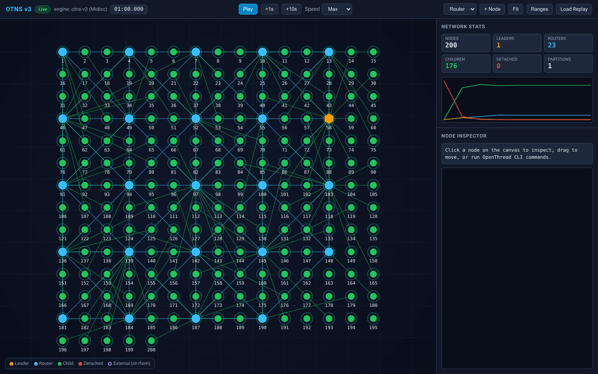

# OTNS v3 Architecture

## 1. Motivation

OTNS v2 proved the value of realistic RF and interference simulation, multi-version Thread interoperability, Matter and OTBR integration, and interactive visualization. Maintaining OTNS v2, however, revealed four structural bottlenecks:

1. **Community language mismatch**: The simulator core is written in Go while nearly the entire OpenThread ecosystem (`openthread`, `ot-br-posix`, `ot-commissioner`, `tests/nexus`, and Matter) is C/C++, limiting the active reviewer pool.
2. **Frontend and transport toolchain rot**: `/web/site` depends on EOL Webpack 4, PixiJS 5, a deprecated native `grpc` C++ Node addon, a 2020 `x86_64`-only `grpcwebproxy` binary, legacy `protoc-gen-go@v1.5.2`, and `go-bindata` committing a 3 MB generated `bindata.go` blob that breaks automated dependency updates.
3. **High-N scaling ceiling**: Running one OS process per node over Unix domain sockets in lock-step virtual time hits file-descriptor limits (`ulimit -n`) and kernel context-switch overhead at 200 to 1,000 nodes.
4. **Fragmentation with Nexus**: `openthread/tests/nexus` and `openthread/ot-ns` maintain separate visualization schemas, radio models, and web UIs.

OTNS v3 resolves all four with a ground-up C++17 architecture designed for layered convergence with Nexus.

---

## 2. Core Design Principles

1. **C++17 with minimal dependencies**: Follows OpenThread's host-C++ style (`openthread/STYLE_GUIDE.md` naming and `.clang-format` enforced via `./script/make-pretty check`). Built with CMake and Ninja under `-Wall -Wextra -Wpedantic -Wshadow -Wconversion -Wsign-conversion -Werror -fno-exceptions -fno-rtti` (root build; `-Werror` is gated by `OTNS_WERROR`), ASan/UBSan clean, with zero Boost, gRPC, Protobuf, or OpenSSL dependencies.
2. **Deterministic single-threaded simulation loop**: One discrete-event scheduler drives virtual time at 1 µs resolution using deterministic seeded PRNGs (`SplitMix64` and `Xoshiro256**`) and deterministic ordered iteration so hash ordering never perturbs RF or scheduling outcomes.
3. **Hybrid node model**: Scales past 500 to 1,000 nodes while preserving external-process fidelity.
   - **In-process multi-instance OpenThread nodes**: Linked against `openthread-ftd` with `OPENTHREAD_CONFIG_MULTIPLE_INSTANCE_ENABLE=1` (emulating MED and SED roles via `otLinkModeConfig`), executing directly on the simulator event loop with zero IPC syscalls or file-descriptor explosion.
   - **External OS-process nodes**: Matter Linux apps, real OTBR/RCP hosts, and custom or older Thread binaries attach to the same RF medium and scheduler via the versioned binary/TLV `ot-rfsim` v3 protocol over Unix or loopback TCP sockets.
   - **Allowlisted process orchestration**: External binaries can be launched directly via `fork`/`execv` (no shell) through `node.spawn` when `--allow-spawn <dir-or-file>` is explicitly configured, supporting `otns`, `matter` (`--thread-arg=`), and `raw` argument styles with UI node labels.
4. **Standalone RF library**: `otns_rf` has zero OS, socket, or OpenThread dependencies so it can be unit-tested in isolation and reused directly by `openthread/tests/nexus`. A 3D spatial grid index keeps `MutualInterference` neighbor lookup scalable past 500 nodes without $O(N^2)$ scans on every transmission.
5. **Single HTTP/WebSocket JSON surface**: One embedded localhost HTTP/1.1 and RFC 6455 WebSocket server handles static assets, JSON-RPC control commands, rate-coalesced visualization diffs (30 to 60 Hz), and `.jsonl` replay streams. A shared JSON Schema contract ([viz_rpc_v1.schema.json](../protocol/schema/viz_rpc_v1.schema.json)) lets the same Vite, TypeScript, and batched Canvas 2D UI target either OTNS v3 or a future Nexus WebSocket observer.
6. **Security by default**: Loopback-only binding (`127.0.0.1`), WebSocket `Origin` validation, canonicalized `--output-dir` containment on all file writes (PCAP, KPI, topology, and replay), explicit `--allow-spawn` opt-in, and zero committed generated web bundles.

---

## 3. Layered Module Architecture

| CMake / Module Target | Path | Dependencies | Purpose |
| :--- | :--- | :--- | :--- |
| `otns_rf` | `src/rf/` | C++17 stdlib only | Deterministic PRNG, 3D spatial grid index, ITU/3GPP path loss, shadow and time-variant fading, IEEE 802.15.4 SINR/BER error model, and five RF presets (`Ideal`, `IdealRssi`, `MutualInterference`, `Midisc`, `Outdoor`). |
| `otns_protocol` | `src/protocol/` | C++17 stdlib only | Versioned `ot-rfsim` v3 binary/TLV encoder and bounds-checked decoder shared with external `ot-rfsim` v3 nodes. |
| `otns_inproc_platform` | `src/nodes/` | `otns_rf`, `openthread-ftd` | Multi-instance OpenThread platform shims for in-process nodes. |
| `otns_core` | `src/core/`, `src/nodes/` | `otns_rf`, `otns_protocol`, `otns_inproc_platform`, `openthread-ftd`, `openthread-cli-ftd`, `mbedtls`, `nlohmann/json` | Discrete-event scheduler, `SimNode` abstraction, `InProcNode`, `RfSimNode` external socket bridge, PCAP/WPAN-TAP writer, 802.15.4 dissector, KPI tracker, virtual TREL/infra-if/host UDP fabric, and JSON topology loader. |
| `otns_server` | `src/server/` | `otns_core` | Embedded POSIX `poll()` HTTP/1.1 and WebSocket server, Unix JSON-RPC server, RPC handler, coalesced `VizPublisher`, and JSONL recorder/replayer. |
| `otns` | `src/cli/` | `otns_server`, `otns_core` | Daemon binary and interactive CLI REPL. |
| `openthread-rfsim-v3` / `openthread-rfsim-v3-rcp` | `ot-rfsim/` | `openthread`, `otns_protocol` | Standalone OpenThread platform for external binaries (`ot-cli-ftd-rfsim`, `ot-rcp-rfsim`) and Matter GN library mode (`ot-rfsim/BUILD.gn`, supporting FTD and MTD). Note: CMake builds force `OT_MTD=OFF`; standalone `ot-rfsim/CMakeLists.txt` does not inherit root `otns_build_options`. |
| `web` | `web/` | Vite, TypeScript | Batched HTML5 Canvas 2D visualizer (with LOD culling for 500 to 1,000 nodes), Stats view, and Replay player. Optional at build time (`-DOTNS_BUILD_WEB=OFF` requires no Node.js). |
| `python/otns` | `python/` | Python 3.10+ stdlib | Typed synchronous Python SDK over WebSocket or Unix JSON-RPC, plus `unittest` integration and scale test suite. |

---

## 4. Current Status and Future Work

### Implemented on `v3`

- **Core simulator and hybrid bridge**: Deterministic C++17 discrete-event core, `otns_rf`, `otns_protocol`, in-process multi-instance OpenThread 1.4 nodes, external `ot-rfsim` v3 FTD and Spinel/HDLC `ot-rcp-rfsim` nodes, virtual TREL and Infrastructure Interface (AIL) bridging, PCAP/WPAN-TAP, KPI JSON, and topology save/load.
- **Visualization, SDK, and CI**: Embedded HTTP/WS/Unix JSON-RPC server, build-time embedded Canvas 2D Web UI, JSONL replay, zero-dependency Python 3 SDK, hardened Docker playground (`docker/Dockerfile`), and GitHub Actions CI (`ubuntu-24.04`, `ubuntu-24.04-arm`, `macos-15`, GCC/Clang ASan+UBSan, formatting, and standalone `ot-rfsim` builds).
- **Native Matter-over-Thread integration**: Drop-in `connectedhomeip` GN target ([ot-rfsim/BUILD.gn](../ot-rfsim/BUILD.gn)) and OpenThread 1.4 config ([openthread-core-rfsim-config.h](../ot-rfsim/src/openthread-core-rfsim-config.h)), native Linux builder ([script/build-matter-deps.sh](../script/build-matter-deps.sh)), rootless/isolated-netns end-to-end commissioning and On/Off smoke test ([script/test-matter-smoke.py](../script/test-matter-smoke.py)), and weekly/manual native `ubuntu-24.04` workflow (`.github/workflows/matter-nightly.yml`) without adding a `connectedhomeip` submodule.

### Post-MVP Follow-Ups

- Wire `openthread/tests/nexus` into the shared `viz_rpc_v1.schema.json` WebSocket observer and `web/` visualizer.
- Add optional energy profiling charts, a YAML topology importer, and a multi-version OpenThread build matrix.

---

## 5. Verified Performance and Footprint (Release Build, Linux `x86_64`)

- **100-node C++ benchmark** (`bench_scale 100 30`, `Midisc`): Completes 30 s of simulated time in ~0.22 s wall time (~136× real time), bit-for-bit deterministic across fresh runs and `Simulation::Reset()`.
- **200-node Python SDK scale test** (`scale_200.py`, `Midisc`): Completes 60 s of simulated time in ~0.69 s wall time (~85× real time), converging cleanly to 1 Leader, 23 Routers, 176 Children, 0 Detached, and 1 Partition.
- **Single-binary footprint**: The `otns` Release binary (~2.4 MB) embeds the Vite and TypeScript Canvas 2D bundle (~18.6 KB JS, ~4.5 KB CSS, zero runtime npm dependencies). Standalone `openthread-rfsim-v3` links cleanly against single-instance OpenThread builds (including `OT_RFSIM_TREL=ON` and `OT_RFSIM_BORDER_ROUTING=ON`).

